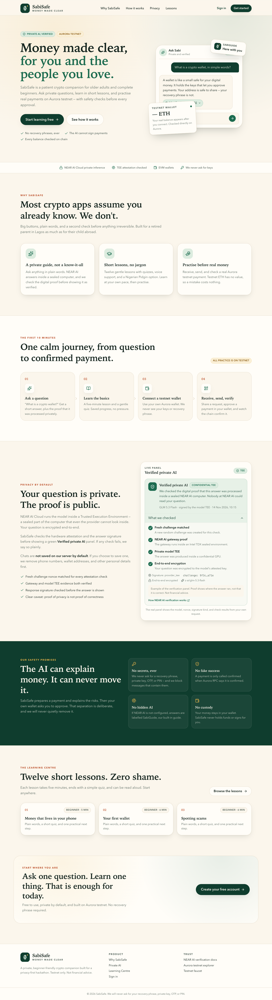
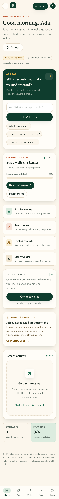
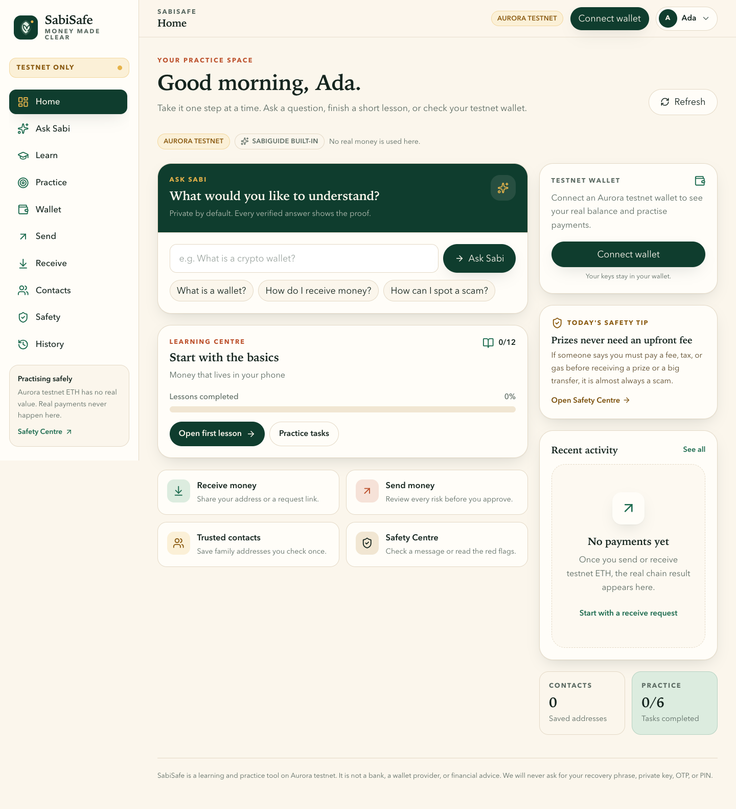
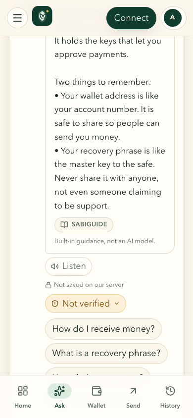

# SabiSafe

**Money made clear — a private, beginner-friendly crypto companion for older adults.**

SabiSafe is a full-stack learning and practice app on **Aurora testnet**, an EVM network. It pairs short lessons and a safety centre with a private, attestation-verified AI guide, and a real wallet flow where the user — never the app and never the AI — approves every payment.

Built for a privacy-first hackathon (primary track: **Privacy**; also **Real World** and **Security**).

---

## The problem

Most crypto apps assume you already understand wallets, addresses, network fees, and scam patterns. That excludes a huge group of people: retired parents, first-time smartphone users, and anyone who has ever been told “just send it, I will explain later.”

The people most targeted by crypto scams are often the least served by crypto UX.

SabiSafe is designed for a retired parent in Lagos as much as for their child abroad:

- 18px base type, a larger-text setting, and high contrast.
- Plain language, short sentences, and Nigerian Pidgin support.
- Voice input and read-aloud answers.
- One decision per screen, with warnings before irreversible actions.
- No recovery phrases, private keys, OTPs, PINs, or wallet passwords — ever.

## What is real in this app

Honesty is a product feature. SabiSafe does **not** ship demo balances, invented transaction hashes, fake attestations, or a placeholder contract address.

| Thing | Source of truth |
| --- | --- |
| Wallet balance | Aurora JSON-RPC `eth_getBalance` |
| Transaction status | Aurora `eth_getTransactionByHash` + `eth_getTransactionReceipt`, never the client |
| Explorer link | Configured Aurora explorer |
| AI answer | NEAR AI Cloud, or clearly-labelled **SabiGuide** fallback |
| AI privacy proof | NEAR AI SDK gateway + model attestation and response signature verification |
| Onchain contacts | The deployed `SabiSafeRegistry` Solidity contract, read through `eth_call` |
| Contract address | Only shown when a real deployment is configured |
| Deployed registry | `0xdcbbde31e98a9a190c3932e562dc723bf56b87f8` on Aurora testnet |

If NEAR AI is not configured, the app says so and labels every answer **SabiGuide — built-in guidance, not an AI model**. If the chain cannot be reached, the app says the balance is unavailable rather than guessing. If a transaction is not confirmed, it is shown as pending or failed — never as “sent”.

## Features

### Private, verifiable AI

- Uses **NEAR AI Cloud** (`https://cloud-api.near.ai/v1`) through the official `@nearai/inference-sdk`.
- Model: `z-ai/glm-5.3-flash`, a private TEE deployment.
- End-to-end encryption between the client app and the model (`NEAR_AI_E2EE=true`).
- Gateway attestation, model attestation, TLS binding, and a fresh challenge nonce are verified with the SDK.
- Each AI response signature is verified before the answer is marked **Verified private AI**.
- A green panel explains exactly what was checked. It also states the limit: proof of *where* an answer ran is not proof that it is *correct*.
- **Privacy by default:** conversations are not stored server-side unless the user turns saving on.
- When saving is on, a local redaction pass removes emails, phone numbers, 0x wallet addresses, transaction hashes, long numbers, hex secrets, and probable recovery phrases before storage.
- Messages that look like they contain a recovery phrase, private key, OTP, PIN, or keystore are blocked before they reach any model, log, or database.

### Learning Centre

- 12 beginner lessons with quizzes, seeded through Prisma.
- Progress and best quiz score saved per user.
- Read-aloud support, Pidgin content, and a related-lesson link from AI answers.
- Lessons cover wallets, recovery phrases, scams, fees, transactions, stablecoins, and a family safety plan.

### Real Aurora testnet wallet flow

- Wallet connection with any **EIP-1193 EVM wallet** (MetaMask, Rabby, Coinbase Wallet, and others).
- **No wallet at all?** The Wallet page runs a five-step plain-language setup guide: install MetaMask from the official site, create the wallet, add Aurora testnet (one button when a wallet is present, copyable network details when it is not), get free testnet ETH, then connect. It detects whether a browser wallet is installed and can re-check after installation.
- SabiSafe asks the wallet to switch to Aurora testnet (chain ID `1313161555`) and adds the network when the wallet does not know it.
- No key material ever reaches the server. The session stores only the public `0x` address.
- Receive page with address, QR code, shareable request links, and a minimal public request view.
- Send page with a server-side preflight: address format and EIP-55 checksum, zero address, activity, new recipient, self-transfer, contract recipient, large amount, and balance sufficiency.
- Warnings must be read; high-risk findings block the send.
- Your own wallet shows the final approval screen. SabiSafe cannot sign for you and the AI cannot sign at all.
- After approval, the server verifies the transaction with Aurora RPC before writing it to history.

### Safety Centre

- Plain-language red flags.
- A message scanner for common scam patterns (requests for secrets, upfront fees, urgency, short links, impossible promises).
- Clear guidance for what to do if a recovery phrase leaked.
- Daily safety tip on the dashboard.

### Trusted contacts + optional onchain registry

- Local trusted contacts with names and relationships.
- A small Solidity contract, `contract/`, that stores a public trusted-recipient list under each user's own address.
- Approving a contact onchain is a real wallet transaction (`addTrusted`). The server verifies the transaction and re-reads the registry before showing the badge.
- The registry is optional. Without a deployed contract, the UI says so and local contacts still work.

### Accessibility

- 18px base font with Large / Extra large settings, saved per device.
- Keyboard-friendly dialogs, visible focus rings, skip link.
- Screen-reader labels on icon buttons, live regions for chat and toasts.
- Reduced-motion support.
- Web Speech API voice input and speech synthesis with graceful fallback when unavailable.
- English and Nigerian Pidgin answer styles.

## A look at the app

| Desktop | Mobile |
| --- | --- |
|  |  |
|  |  |

More real screenshots (register, learning centre, the safety scan, and the wallet
page) are in [`docs/screenshots/`](./docs/screenshots). They were captured from a
real local run against the Render PostgreSQL database. The AI panel shows the
labelled SabiGuide fallback because no `NEAR_AI_API_KEY` was configured at the
time.

## Architecture

```
client/    React 19 + Vite + Tailwind CSS 4 + React Router + Framer Motion + Lucide + viem
server/    Node 24 + Express 5 + Prisma 6 + PostgreSQL + Zod + JWT (httpOnly cookie) + viem
contract/  Solidity 0.8.29 trusted-recipient registry + Foundry tests (Aurora testnet)
```

External services:

- **NEAR AI Cloud** for private inference and attestations.
- **Aurora testnet RPC** (`https://testnet.aurora.dev`) for balances and transaction truth.
- **Aurora explorer** (`https://explorer.aurora.dev`) as optional readable activity enrichment only.
- **Render PostgreSQL** for application data.

The Express server can also serve the built client, so a single Render web service is enough for a demo.

## Requirements

- **Node.js ≥ 24.22.1** (`@nearai/inference-sdk` requires it). `.nvmrc` pins `24.22.3`.
- npm 11+.
- A PostgreSQL database. The project is set up for **Render PostgreSQL**; a local database also works.
- An EVM wallet with Aurora testnet configured. Get free testnet ETH from the [Aurora faucet](https://aurora.dev/faucet).
- Optional: a NEAR AI Cloud API key for live verified AI.
- Optional: [Foundry](https://book.getfoundry.sh/) to build, test, and deploy the registry contract.

## Quick start

```bash
# 1. Install
nvm use            # or install Node 24.22.3 yourself
npm install

# 2. Configure
cp .env.example .env
# Edit .env: DATABASE_URL, JWT_SECRET, and optionally NEAR_AI_API_KEY

# 3. Database
npm run db:generate
npm run db:deploy   # or: npm run db:migrate (development)
npm run db:seed

# 4. Run both apps
npm run dev
```

- Client: http://localhost:5173
- API: http://localhost:3001/api/health

Vite proxies `/api` to the server, so cookies work without CORS surprises.

### Environment

All variables are documented in [`.env.example`](./.env.example). The important ones:

| Variable | Required | Purpose |
| --- | --- | --- |
| `DATABASE_URL` | Yes | PostgreSQL connection string. Use the Render external URL with `sslmode=require`. |
| `JWT_SECRET` | Yes in production | Session signing key. Generate a random 48-byte hex string. |
| `NEAR_AI_API_KEY` | No | Enables live NEAR AI Cloud inference. Without it, SabiGuide fallback is used and labelled. |
| `NEAR_AI_MODEL` | No | Defaults to `z-ai/glm-5.3-flash`. |
| `DNS_FALLBACK_HOSTS` | No | Hosts that may retry against public DNS when the system resolver fails. Defaults to the NVIDIA and Intel attestation hosts. Set to an empty string to disable. |
| `DNS_FALLBACK_SERVERS` | No | Public resolvers used by that fallback. Defaults to `1.1.1.1,8.8.8.8`. |
| `AURORA_CHAIN_ID` | No | Defaults to `1313161555` (Aurora testnet). |
| `AURORA_RPC_URL` | No | Defaults to `https://testnet.aurora.dev`. |
| `AURORA_REGISTRY_ADDRESS` | No | Deployed `SabiSafeRegistry` address. Without it, onchain contact approval is disabled. |
| `AURORA_EXPLORER_URL` | No | Defaults to `https://explorer.aurora.dev`. |
| `AURORA_ACTIVITY_URL` | No | Explorer API used only for readable activity. Falls back gracefully. |
| `AURORA_FAUCET_URL` | No | Testnet ETH faucet link shown in the UI. |
| `CLIENT_URL` | Yes in production | Exact public origin, used for CORS and share links. |
| `CORS_ORIGINS` | No | Extra comma-separated origins allowed to call the API (for a split client/API deploy). |
| `COOKIE_SECURE` | Production | Set `true` behind HTTPS. |
| `COOKIE_SAME_SITE` | No | `lax` for a single origin (default). Use `none` with HTTPS only when the client and API are on different sites. |
| `TRANSACTION_LARGE_AMOUNT_ETH` | No | Large-payment warning threshold in ETH. Default `0.01`. |

`VITE_*` variables are public. Never put a secret in one. The client reads network and contract details from `/api/config`, so no chain variable is required at build time.

### Database

The schema is in `server/prisma/schema.prisma`. Models: users, learning lessons and progress, conversations and messages, wallet connections, trusted contacts, transactions, receiving requests, and practice progress.

Amounts are stored in **wei** as exact strings. The `Network` enum uses `AURORA_TESTNET` / `AURORA_MAINNET`, and the native asset defaults to `ETH`.

The seed creates **only** 12 lessons. It does not create demo users, balances, or transactions.

```bash
npm run db:generate -w server
npm run db:deploy -w server   # production / Render
npm run db:seed -w server
```

Prisma CLI reads `server/.env` or `server/prisma/.env`. The app itself reads the repo-root `.env` and `server/.env`. Putting `DATABASE_URL` in `server/.env` makes both work.

## Graceful fallbacks

| Missing thing | Behaviour |
| --- | --- |
| `DATABASE_URL` | Server still boots; database routes return a clear `503 DATABASE_NOT_CONFIGURED`. Health reports `database: unavailable`. |
| Prisma client not generated | Same `503` with instructions to run `db:generate`. |
| `NEAR_AI_API_KEY` | SabiGuide fallback answers, explicitly labelled as built-in guidance. Attestation panel says it is not configured. |
| NEAR AI request or verification failure | User sees SabiGuide fallback plus the reason, and is told the answer is not verified. SabiSafe never presents an unverified answer as verified. |
| Aurora explorer unavailable | Wallet page says activity enrichment is unavailable; balances and transaction verification still work through Aurora RPC. |
| Registry contract not deployed | Contacts still work locally. The UI explains that onchain approval is unavailable. |
| No EVM wallet in the browser | A plain message asks the user to install MetaMask or another EVM wallet. Nothing is signed. |
| Wrong network in the wallet | SabiSafe requests a switch to Aurora testnet and offers to add it. |
| Wallet rejected / cancelled | Clear “nothing was sent” message. No transaction row is created. |
| Transaction not found yet | Shown as pending with a retry path. Never marked confirmed. |
| Browser lacks speech APIs | Voice controls are hidden or show a plain fallback message. |

## API

Base path: `/api`. Auth uses an httpOnly, SameSite=Lax cookie. See [`docs/API.md`](./docs/API.md) for the full route list.

Highlights:

- `POST /auth/register`, `POST /auth/login`, `GET /auth/me`
- `GET /dashboard`
- `GET /lessons`, `GET /lessons/:slug`, `POST /lessons/:slug/quiz`
- `POST /ai/chat`, `GET /ai/attestation`, `GET /ai/conversations`
- `GET /wallet`, `POST /wallet/connect`, `GET /wallet/activity`
- `POST /safety/preflight`, `POST /safety/scan-message`
- `POST /transactions/verify`, `POST /transactions/:hash/refresh`
- `GET/POST /contacts`, `POST /contacts/:id/confirm-onchain`
- `GET/POST /receiving`, `GET /receiving/public/:id` (public)
- `GET /practice`, `POST /practice/:key/complete`

## Contract

See [`contract/README.md`](./contract/README.md) for methods, security notes, tests, build, and deploy commands.

The contract is deliberately small:

- owner-scoped trusted lists, keyed on `msg.sender`;
- non-payable, no custody, no owner or admin key, no upgrade proxy;
- `addTrusted`, `removeTrusted`, `isTrusted`, `listTrusted`, `countTrusted`, `version`;
- events for every mutation;
- Foundry tests for duplicate adds, per-owner isolation, removal, self-trust rejection, zero address rejection, and owner-only removal.

Deployed to Aurora testnet on 2026-11-14:

| | |
| --- | --- |
| Address | `0xdcbbde31e98a9a190c3932e562dc723bf56b87f8` |
| Deployment tx | [`0x18102e58c32cb2650fba3878f8e5b4e0b03aff5b80b9ddb352031406706ff4c4`](https://explorer.aurora.dev/tx/0x18102e58c32cb2650fba3878f8e5b4e0b03aff5b80b9ddb352031406706ff4c4) |
| Deployer | `0x8eac9D1bb08bdDC7abf83a5DA761bD3E715fD223` |
| Gas used | 395,797 |

Verified on chain: `version()` returns `1.0.0` and `listTrusted(deployer)` returns an empty list.

## Tests

```bash
npm test                 # server unit + API smoke tests (Vitest)
npm run test:e2e         # Playwright smoke tests (desktop + mobile)
cd contract && forge test
```

Server tests cover ETH/wei amount math, EVM address validation, redaction and secret blocking, transfer risk rules, scam scanning, the guide fallback, and API behaviour without a database.

The Playwright tests use your installed Google Chrome by default and start both the API and a Vite dev server on dedicated ports. To use the Playwright-managed Chromium instead (for example in CI), run `npx playwright install chromium` and set `PLAYWRIGHT_CHANNEL=bundled`.

## Deploying the registry contract

Deployment must happen from your own wallet. Never commit a private key or recovery phrase.

Aurora's public RPCs do not implement `eth_getProof` (needed by Forge's fork
simulation) or `eth_feeHistory` (needed for EIP-1559 estimation), so
`contract/deploy.sh` passes `--skip-simulation` and `--legacy`, picks a
responding RPC, and checks the signer balance first.

```bash
cd contract
export PATH="$HOME/.foundry/bin:$PATH"

# One-time: encrypted Foundry keystore (prompts locally)
cast wallet import sabisafe --interactive

# Deploy, also accepts --ledger
./deploy.sh --account sabisafe --write-env
```

Or paste `src/SabiSafeRegistry.sol` into Remix: chain id `1313161555`, EVM
version **Paris**, no constructor arguments, deploy with MetaMask.

Then set `AURORA_REGISTRY_ADDRESS` to the deployed address, restart the API, and confirm `/api/config` reports `onchainRegistry: true`.

## Deploying to Render

1. Create a Render PostgreSQL instance and copy the **external** connection string.
2. Create a Web Service from this repository.
3. Build command:

   ```bash
   npm install && npm run db:generate && npm run build
   ```

4. Start command:

   ```bash
   npm run db:deploy && npm run db:seed && npm start
   ```

5. Set environment variables from `.env.example`. Use:
   - `NODE_ENV=production`
   - `COOKIE_SECURE=true`
   - `CLIENT_URL=https://your-service.onrender.com`
   - a strong `JWT_SECRET`
   - `DATABASE_URL` with `sslmode=require`
   - `AURORA_REGISTRY_ADDRESS=0xdcbbde31e98a9a190c3932e562dc723bf56b87f8` (the live Aurora testnet deployment)

The server serves `client/dist` when it exists, so the app and API share one origin.

## Privacy and security design

- Passwords hashed with bcrypt (cost 12).
- JWT in an httpOnly, SameSite=Lax cookie; `Secure` in production.
- Helmet security headers; strict CORS allow-list; JSON body limits.
- Zod validation on every write route.
- Rate limits: general, auth, AI, and transaction-specific.
- Parameterised Prisma queries.
- AI history off by default; redaction before persistence.
- Secret-looking messages blocked before inference.
- Server never accepts a client-declared transaction status; it always re-reads the chain.
- Transaction writes require the transaction to involve the user's connected wallet, and onchain contact approval requires the transaction to come from that wallet and go to the configured registry.
- The AI has no tool that can sign, approve, or move funds.

### What SabiSafe will never collect

Recovery phrases, private keys, keystore files, OTPs, PINs, or wallet passwords. If a page or person asks for them, it is not SabiSafe.

## Known limitations

- **Testnet only.** There is no mainnet mode. Aurora testnet ETH has no real value.
- **Registry contract deployed to Aurora testnet only.** The address is `0xdcbbde31e98a9a190c3932e562dc723bf56b87f8`; there is no mainnet deployment. SabiSafe reads it through `eth_call` and degrades gracefully when the RPC is unreachable.
- **No live NEAR AI key in the repository.** Without one, the app runs the labelled SabiGuide fallback. Attestation cannot be verified without the provider. Response verification also needs outbound access to NVIDIA's and Intel's attestation hosts; the `DNS_FALLBACK_*` settings cover resolvers that block them.
- **No fiat on/off ramp, no custody, no investment features.** These are intentional.
- **Voice input depends on the browser.** Chrome/Edge support is best; Safari and Firefox may vary.
- **The Aurora explorer is enrichment only.** It can be rate-limited or unreachable without affecting core money flows.
- **The AI can be wrong.** Verification proves the execution environment, not factual accuracy. The UI says this repeatedly.

## Hackathon tracks

- **Privacy (primary):** private-by-default AI, NEAR AI Cloud TEE inference, end-to-end encryption, attestation and response verification shown to the user, redaction before any persistence, secret blocking before inference.
- **Real World:** designed for older adults and first-time users in Nigeria and the diaspora; Pidgin, voice, large type, family safety planning, testnet practice before real money.
- **Security:** no key custody, wallet-only signing, chain-verified transaction status, preflight risk checks, scam scanner, onchain trusted-recipient registry, calm high-risk blocking.

## Documentation

- [`docs/API.md`](./docs/API.md) — API reference
- [`docs/DEMO_SCRIPT.md`](./docs/DEMO_SCRIPT.md) — a 3-minute demo path
- [`docs/SUBMISSION_CHECKLIST.md`](./docs/SUBMISSION_CHECKLIST.md) — what must be real before submitting
- [`contract/README.md`](./contract/README.md) — contract details

## License

MIT. See [`LICENSE`](./LICENSE).

---

SabiSafe is a learning and practice tool on Aurora testnet. It is not a bank, a wallet provider, or a financial adviser. We will never ask for your recovery phrase, private key, OTP, or PIN.
